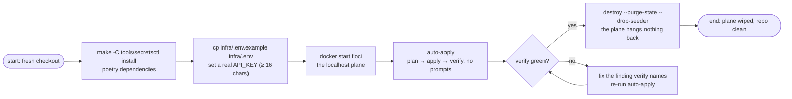

# Quick Start

Get the engine running, then drive a real service's whole secrets plane locally — end to end on the emulator — before any real AWS is in play. The whole loop is **install → dry-run → auto-apply → verify**, all on an emulator plane that asks for nothing and costs nothing.

## Prerequisites

| Need | Check | Notes |
|------|-------|-------|
| Poetry (Python ^3.11) | `poetry --version` | the engine is a Poetry package |
| Terraform ~> 1.10 | `terraform version` | the stack pins it (1.10+ for the lockfile backend on real AWS) |
| AWS CLI v2 | `aws --version` | the engine shells out to it for identity, STS, IAM, S3, SM, SSM |
| Floci (or LocalStack) | `docker start floci` | the emulator plane on `http://localhost:4566` — needed only for local-plane runs |

Install, so the `secretsctl` command exists inside Poetry's environment:

```sh
make -C tools/secretsctl install
```

The commands below call it Poetry-wrapped from the repo root; after `install`, `secretsctl ...` works from anywhere too.

## Step 1: a service to drive

`document-parser` is already onboarded — it ships a [declaration](../concepts/declaration.md) at `services/document-parser/secrets.toml`. Only its values file may be missing on a fresh checkout:

```sh
cd services/document-parser
cp infra/.env.example infra/.env    # then set API_KEY to something with ≥ 16 chars
cd -
```

Its `.env` doubles as the [values file](../concepts/values.md) the engine validates and feeds.

## Step 2: read what would happen

```sh
poetry -C tools/secretsctl run secretsctl --service document-parser plan --dry-run
```

Dry runs are safe on machines with no cloud access at all: you get the banner (plane, keys as lengths, the derived bucket and state key, the backend overrides) and nothing more. Every list of steps below starts here in practice.

## Step 3: build and prove the plane

```sh
docker start floci                                                        # the emulator plane must exist
poetry -C tools/secretsctl run secretsctl --service document-parser plan  # preview the terraform diff
poetry -C tools/secretsctl run secretsctl --service document-parser auto-apply
```

`auto-apply` chains plan → apply (auto-approved on the emulator) → verify in one verb, aborting at the first failure. A first run *will* print two posture notes on the way in — `note: seeder role … is missing; creating it` and the state-bucket create for its derived name — both are normal [self-heals](../concepts/carrier.md#one-verbs-ride-through-the-carrier) on a brand-new plane, and the session they mint is cached for the 12-hour window.

Afterwards, either run's proof is a `verify` away at any time:

```sh
poetry -C tools/secretsctl run secretsctl --service document-parser verify
# ...
# ok:      the seeded plane matches the .env values
```

## Step 4: tear it down (the loop ends as cleanly as it began)

```sh
poetry -C tools/secretsctl run secretsctl --service document-parser destroy --purge-state --drop-seeder
```

Teardown never waits for input: destroy auto-approves on both planes, with `--purge-state` the purge previews what it will wipe first (and warns when the bucket holds objects outside `document-parser/`), and the seeder role drops last. This leaves `services/document-parser` in the same shape you started in and the emulator's plane empty.

## The first-run path in one picture



## Troubleshooting the first run

| Symptom | Meaning | First move |
|---------|---------|------------|
| `error: services/.../infra/.env not found` | step 1 not done for this service | copy the committed `.env.example` |
| validation ladder `error:` lines | values don't satisfy the declaration yet | the `fix:` line after each error tells you what to set |
| state-bucket create failing / init failing on the emulator | Floci is down or not on `localhost:4566` | `docker start floci`, or move it behind `SECRETSCTL_FLOCI_URL` |
| a real-AWS run asks for an MFA code and you have no device surfaced | the trust ladder needs a pin | set `SEEDER_MFA_SERIAL` in `.env` ([carrier](../concepts/carrier.md)) |

## Next Steps

- **[Onboarding a service](../guides/onboarding-a-service.md)** — give a *new* service its two files and drive its plane
- **[Architecture](../concepts/architecture.md)** — the verb dispatch and the three credential sources behind this run
- **[CLI reference](../reference/cli.md)** — every verb and flag you have met today, formally

| Command | What it does |
|---------|--------------|
| `make -C tools/secretsctl help` | the raw target index |
| `make -C tools/secretsctl test` | the unit suite (no emulator needed) |
| `... plan --dry-run` | the always-safe stakeout of any verb |
| `... destroy --purge-state --drop-seeder` | leave no trace |
