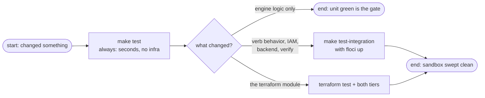

# Testing

The engine's confidence comes from two tiers that prove different things, plus the terraform module's own contract tests. The default `make test` runs the fast tier only — an integration run needs infrastructure, and it is honest about needing it.

## Tier 1: unit — the default gate

```sh
make -C tools/secretsctl test          # (test-unit is an alias)
```

Fast, subprocess-mocked, no network, no emulator: every verb's logic against fakes — value validation, backend composition, trust/policy documents, cache margins, dispatch guards, and verify's fingerprint comparisons. It runs by default in CI-shaped pytest invocations (`-m "not integration"` via `addopts`), and `make test-cov` fails the run below 65% coverage.

| Bridge with a fake | What it lets the test assert |
|--------------------|------------------------------|
| fake subprocess runs | verb orchestration, env overlays (`AWS_PROFILE` stripped), banner correctness |
| fake `secrets.toml` + `.env` fixtures | every schema and value-ladder law with all its error wording |
| computed policy/trust documents | least-privilege shape: statement scopes, ARN pins, the one account-level wildcard |
| fake session files and clocks | the 12-hour/10-minute cache margin, atomic-write behavior, clear/refresh semantics |

## Tier 2: integration — the live Floci run

```sh
make -C tools/secretsctl test-integration   # unit + integration together: test-all
```

These are true black-box runs: `python -m app <verb>` as a subprocess, stdout asserted on the way out. [Floci](#setup-a-floci-instance) stands in for AWS, and the suite holds a strict leave-nothing contract:

- every test drives a **throwaway service**: a unique `itn-<hex>` slug and a two-file workspace in a temp dir — the same minimal footprint a real onboarding has
- teardown re-runs the full destroy chain after every test, even when the test body failed (prompt-free and rerunnable on the emulator)
- a session-hygiene gate sweeps stale `itn-*` leftovers at startup and asserts namespaces end empty; survivors are treated as bugs, not warnings
- `stdin` is `/dev/null` throughout, so any prompt would fail the run — proving the emulator plane never asks
- tests [skip](#what-happens-when-floci-is-missing) when the endpoint is not reachable; the default `SECRETSCTL_FLOCI` / `localhost:4566` can be overridden by env

What the tier buys that mocking cannot: convergence against a real IAM, apply → plan idempotency (*No changes*), tamper → verify exit 1 → heal, teardown then re-apply self-heal, and the batch verb riding the cache across reruns.

## Tier 3: terraform contract tests

```sh
cd tools/secretsctl/terraform && terraform test   # mocked AWS provider; no emulator, no creds
```

Asserts the [derived names](../concepts/declaration.md#what-the-slug-derives) at the stack level: the secret name and SSM prefix follow the slug, seeded parameters land on the service prefix, and an unset SSM map seeds nothing.

## Choosing a tier



## Set up a Floci instance

The integration tier expects an AWS-API emulator on the default engine endpoint. The repo's convention is a container named `floci`:

```sh
docker start floci                        # start your Floci container
aws --endpoint-url http://localhost:4566 sts get-caller-identity   # the reachability probe the suite itself uses
```

Anything emulating the five AWS APIs the run touches (S3, Secrets Manager, SSM, IAM, STS) on the [engine endpoint](../concepts/values.md#the-plane-decided-by-the-flag-never-by-the-file) works; `SECRETSCTL_FLOCI_URL` points the engine elsewhere, and `SECRETSCTL_FLOCI` points the *suite's* probe.

## What happens when Floci is missing

The integration fixture probes first and skips cleanly with a reason when nothing is listening — a quiet, clean skip rather than a red run; it also prints the override hint when it does. Nothing about the unit tier needs the emulator to exist.

## Next Steps

- **[CLI reference](../reference/cli.md)** — the verbs these tests drive
- **[Verification](verifying.md)** — the drift semantics the integration suite exercises (tamper → verify → heal)
- **[Onboarding a service](onboarding-a-service.md)** — a green run on both tiers is part of bringing a service up
