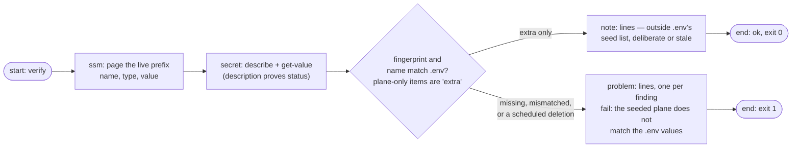
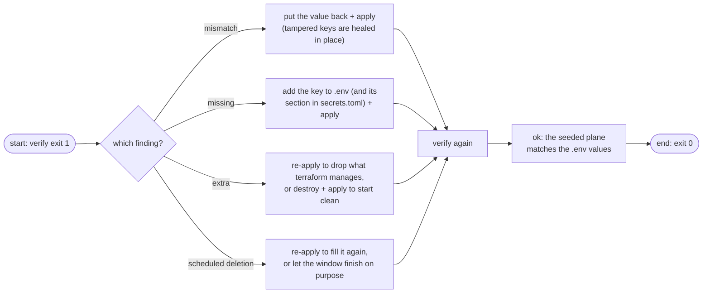

# Verification

`verify` answers one question with evidence instead of trust: what is *actually on the plane right now*, and does it equal what `infra/.env` would seed? Terraform's ledger is not consulted — reality is read fresh from AWS and matched against your values.

It rides the same carrier session as the writing verbs, and prints every secret as **lengths and fingerprints** — never a value ([why](#no-value-ever-prints)).

## What it reads

| Read | Call | Purpose |
|------|------|---------|
| every parameter under the prefix | `ssm get-parameters-by-path --path /detectai/<slug>/ --with-decryption` | the config plane, paginated by the CLI's own `NextToken` loop |
| the secret's status | `secretsmanager describe-secret` | catches a secret **scheduled for deletion** |
| the stored blob | `secretsmanager get-secret-value` | the JSON `{KEY: value}` inside the secret |

## How the comparison works

Each seeded value (what `.env` would put on the plane) is compared to its live counterpart by fingerprint — the first 12 hex characters of a SHA-256 of the UTF-8 bytes. Equal fingerprints carry the same bytes; that is the whole proof, and it is exactly as strong as equality needs to be.



The output is a printable audit:

```text
plane:   real AWS
carrier: role session (detectai-document-parser-seeder, valid 11:41:07)
region:  ap-southeast-2
ssm:     /detectai/document-parser/
  MAX_PDF_PAGES               String   len 4    fp 3f2b9a1d8c4e
  ...
secret:  detectai/document-parser/secrets
  API_KEY                              len 22   fp 9d8f3c1a2b4e
ok:      the seeded plane matches the .env values
```

| Verdict line | Means |
|--------------|-------|
| per-row `… len N fp XXXXXXXXXXXX` | the plane's key with its length and fingerprint |
| `extra: <name>` | on the plane but not in `.env`'s seed list (stale leftovers count) — a note, never a failure |
| `missing (expected from .env)` | declared for the plane, absent from it — a problem |
| `mismatch (expected fp …)` | the plane's bytes differ from your `.env` bytes — a problem |
| secret scheduled for deletion | a problem, even if every key currently matches — destroy is already in motion |
| `ok:` / `fail:` | the verdict, and the exit code follows it |

## The drift-heal loop

Verify failing is information, not damage. Each finding has its own cure:



One expectation `verify` deliberately does *not* run: the full [value ladder](../concepts/values.md). It only sanity-checks `AWS_REGION`. The comparison must remain available even while a value is misedited — refusing to compare would hide the drift it exists to find. The ladder gates the writing verbs instead.

A secret that does not exist on the plane is its own finding, with the fix inline:

```text
error: could not describe the secret detectai/<slug>/secrets
fix:   the secret does not exist on this plane — run the apply verb
```

## No value ever prints

Two numbers per row instead of one string: the **length** (you can see presence and rough shape) and the **fingerprint** (you can compare without seeing). The fingerprints printed for the live plane equal the fingerprints computed locally from `.env` when they match, which is why a row is a sentence of proof, not a confession of what the value is. Keep the same habit in your own tooling around this plane.

`--dry-run` prints the exact three AWS commands the run would issue and touches nothing.

## Next Steps

- **[The terraform lifecycle](terraform-lifecycle.md)** — the apply that fills and the destroy that empties a plane
- **[Values](../concepts/values.md)** — what is expected of the `.env` before anything compares
- **[Carrier](../concepts/carrier.md)** — whose credentials read the plane (the seeder's)
