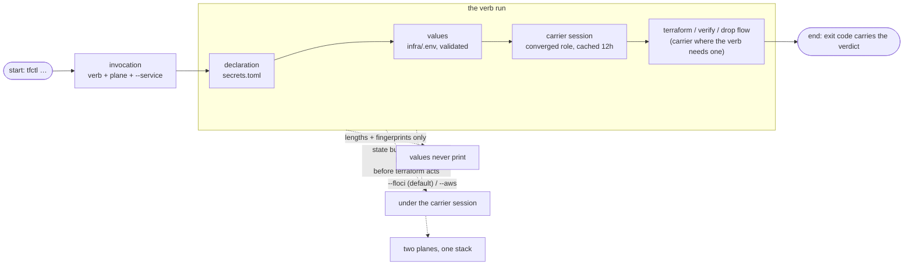

# tfctl Documentation

Welcome to the tfctl documentation. This guide covers how the engine takes two files per service — a committed `secrets.toml` and a gitignored `infra/.env` — and turns them into a governed AWS secrets plane.

**The engine in one sentence:** a service-agnostic CLI that validates a service's values, terraform-drives its secrets stack (a JSON blob on Secrets Manager plus config parameters in SSM), verifies the live plane against the values, and tears it all down — with the state bucket and the seeder carrier role created on demand, on either an emulator or real AWS.

## New to tfctl?

Start here:

1. **[Quick Start](getting-started/quickstart.md)** — install the engine and drive a real service end to end on the emulator
2. **[Architecture](concepts/architecture.md)** — how one invocation becomes a governed AWS change
3. **[Onboarding a service](guides/onboarding-a-service.md)** — the two files that add a service to the plane

## Documentation by Topic

### Concepts

| Document | What You'll Learn | When to Read |
|----------|-------------------|--------------|
| [Architecture](concepts/architecture.md) | Module map, verb dispatch, credential precedence, the output contract | Understanding the system |
| [Declaration](concepts/declaration.md) | The `secrets.toml` schema, slug law, every derived name | Writing or reviewing a declaration |
| [Values](concepts/values.md) | The `.env` roles, the validation ladder, how the plane is chosen | A key refuses to seed, or `.env` edits |
| [Carrier](concepts/carrier.md) | The seeder role: trust ladder, MFA, the cached 12-hour session | IAM prompts, session cache questions |

### Guides

| Guide | What You'll Learn | When to Read |
|-------|-------------------|--------------|
| [The terraform lifecycle](guides/terraform-lifecycle.md) | The verb anatomy, backend composition, state healing, teardown | plan/apply/destroy behavior, or a run surprises you |
| [Verification](guides/verifying.md) | The fingerprint audit, findings vs extras, the drift-heal loop | "is the plane actually right?" |
| [Onboarding a service](guides/onboarding-a-service.md) | The two-file adoption path, step by step | Bringing up a new service |
| [Testing](guides/testing.md) | Unit vs live-Floci integration tiers, the terraform contract tests | Verifying changes |

### Reference

| Document | What You'll Learn | When to Read |
|----------|-------------------|--------------|
| [CLI reference](reference/cli.md) | Every verb, flag, guard rule, exit code, scriptable receipt | Any command-line work |
| [Make targets](reference/make.md) | The tool-tree's make layer, including the secrets-verb wrappers | Building, linting, testing, or driving the engine |

## The engine at a glance



Three conventions ride on top of the diagram: every verb that touches the plane rides the converged seeder role rather than your personal keys, every plane-writing run heals its state ledger before terraform acts, and values appear only as lengths and fingerprints — the printed `ok:`/`error:`/`fix:` receipt plus the exit code is the whole verdict surface.

## Project Structure

```
tools/tfctl/
├── app/                     the engine and the kind it drives
│   ├── main.py              verb dispatch: flags, discovery, kind wiring
│   ├── engine/              stack-agnostic machinery: carrier, stack, values, shell
│   ├── kinds/               the registry; the secrets kind (declaration, verb flows)
│   └── __main__.py          python -m app
├── tests/                   unit (default) + integration (live Floci)
├── mk/                      make fragments
└── docs/                    this documentation
```

## Quick Reference

```bash
make -C tools/tfctl install && make -C tools/tfctl test   # ready to drive
poetry -C tools/tfctl run tfctl --service document-parser plan --dry-run
poetry -C tools/tfctl run tfctl --service document-parser auto-apply   # on floci
poetry -C tools/tfctl run tfctl --service document-parser destroy --purge-state --drop-seeder
```

Per-service one-command ergonomics (document-parser's `make secrets-*`) are thin wrappers over this CLI; the [CLI reference](reference/cli.md) is the canonical surface.
