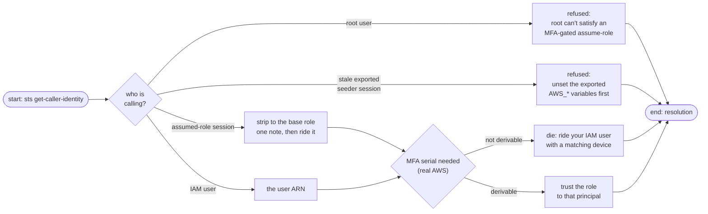
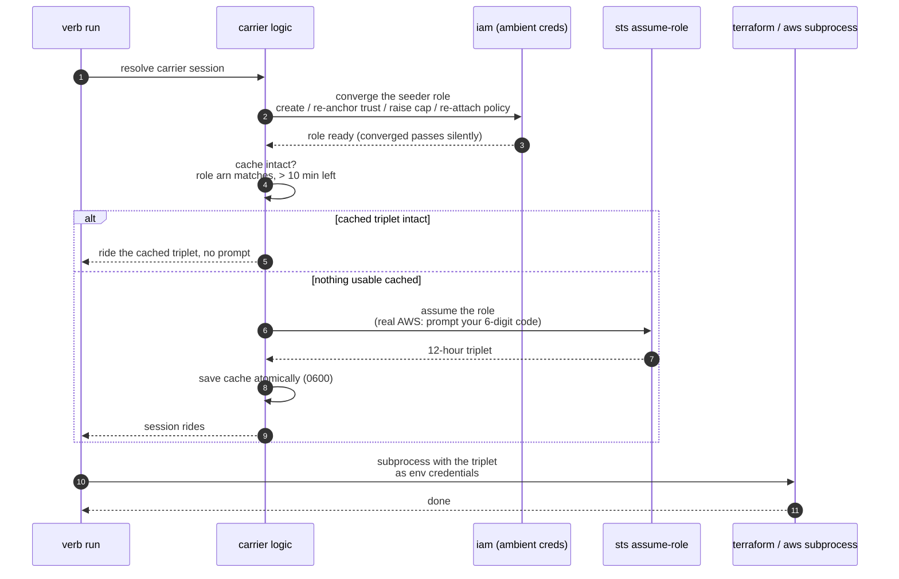
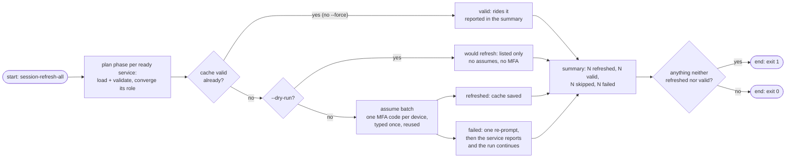

# Carrier

Every verb that works the plane — on both planes — rides the stack's **seeder carrier role**: a small IAM role named `detectai-<slug>-seeder` that sits *outside* the terraform stack on purpose. Whatever such a verb does to AWS, it does it as an assumed seeder session, never with your personal keys.

| Concept | Value |
|---------|-------|
| Role name | `detectai-<slug>-seeder` |
| Inline policy | `seeder-policy` (generated from the declaration — a service never authors IAM) |
| Session | one STS assume-role, **12 hours**, cached locally |
| Cache | `tools/tfctl/.session-cache/<slug>.json` (gitignored, owner-only `0600`) |
| Trust | whoever runs the tool — your ambient credentials, or a placeholder on the emulator |

## Why the role is out of the stack

Terraform owns *data* — the secret blob and the SSM parameters. The seeder owns *lifecycle* — everything writing those resources must exist first: the state bucket terraform reads its ledger from, and the caller-side permissions terraform needs to act. Putting IAM-for-IAM inside the stack creates a circular dependency, so the carrier role is deliberately engine-managed, created and converged on demand by any verb.

Least privilege applies, service-pinned by the same derived names as everything else:

| Policy statement | Grants | Scopes to |
|------------------|--------|-----------|
| `RunTerraformStateBucket` | bucket create/version/list/delete | `detectai-<slug>-tfstate-<account>` |
| `RunTerraformStateObjects` | state object read/write/delete | `…-tfstate-<account>/*` |
| `ManageServiceSecret` | Secrets Manager create/update/read/delete/tag | `detectai/<slug>/secrets` |
| `ManageServiceConfig` | SSM put/get/delete/tag | `/detectai/<slug>/*` |
| `DescribeSsmParameters` | `ssm:DescribeParameters` | `*` — one honest wildcard: IAM offers that call at account level only |

Nothing else. The verb runner is twenty minutes of work out of a service's day; it cannot read a sibling service's secrets because there is no permission to.

## Who the role trusts

The trust is re-anchored to the *ambient caller* (whatever `aws sts get-caller-identity` resolves — env creds, a profile, SSO) whenever a session resolves:



- A caller that *already is* a seeder session is refused, with the fix spelled out — stale exported triplets fail loudly instead of silently bypassing the role.
- An assumed-role caller is flattened to its base role (an assumed-role session can't re-assume under its sub-ARN) and a note explains the substitution.
- On real AWS the trust carries an `aws:MultiFactorAuthPresent` condition, which is why the *whole* path demands MFA and refuses root.
- The emulator enforces no trust conditions at all, so it gets a structural placeholder ARN and needs no code.

## One verb's ride through the carrier



The subprocess rule worth knowing: **env credentials outrank named profiles**, so the triplet always wins and nothing is ever written to `~/.aws`. The runner also strips `AWS_PROFILE` from the subprocess environment so no profile sneaks underneath.

## Cached versus fresh

A cache hit needs three things: the same role ARN, a coherent file, and **more than the 10-minute renewal margin** remaining on the 12 hours. Anything else reads as "no cache" and a fresh (MFA-gated on real AWS) assume repopulates it — atomic write, owner-only permissions; a cache-write failure costs convenience, never the verb run.

That margin is why a plan → apply stretch prompts for the MFA code **once**: the code you typed 40 seconds ago is still riding.

The flyer printed on every non-dry-run confirms the ride:

```text
carrier: role session (detectai-document-parser-seeder, valid 11:58:02)
```

Dry runs resolve no session at all — they print `carrier: role session (promoted when the command runs)` and nothing is assumed, nothing is prompted.

## The session verbs

| Verb | Acts on | What it does |
|------|---------|--------------|
| `session-clear` | one service | delete its cached triplet; the next verb assumes again |
| `session-clear-all` | every service | delete all cached triplets (no `--service` allowed here) |
| `session-refresh-all` | every **ready** service | mint fresh triplets in one run, or just report |

"Ready" means the two files exist: a committed `secrets.toml` plus an `infra/.env`. A service missing either is not a batch candidate.

`session-refresh-all` in one run:



The one-code-per-device trick: real AWS gates each assume behind an MFA prompt, but the code is collected **per device, lazily, once** — ten services pinned to the same authenticator cost one keystroke round, not ten. A failed assume earns exactly one re-prompt (the read is "the device's window rolled over", not "your code is wrong") before the service is declared failed — and a failing service *reports* while the batch moves on.

## Dropping the carrier

`--drop-seeder` (a destroy-time step) and the `seeder-drop` verb delete the inline policy and then the role. These are the one teardown steps that do **not** ride the seeder session — a role cannot assume itself — so they run on your ambient personal credentials, like the trust resolution itself.

## Next Steps

- **[The terraform lifecycle](../guides/terraform-lifecycle.md)** — what the carrier session is spent on
- **[Values](values.md)** — what the `.env` values plane seeds and steers
- **[CLI reference](../reference/cli.md)** — exact flags and guard rules for the session verbs
