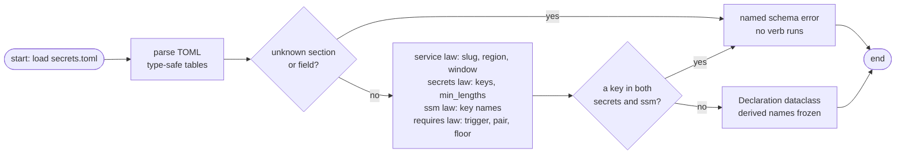

# Declaration

The declaration is a stack's committed toml file that opts it into the engine. The secrets kind's is a service's committed `secrets.toml` at the service root ([Kinds](kinds.md) covers both kinds' files). It declares the **shape** of the service's secrets plane — which keys are secret, which are plain config, how long a secret must be — and never a single value. Values live somewhere else entirely, in the gitignored `infra/.env` ([Values](values.md)).

That split is the tool's founding law:

| File | Committed? | Holds |
|------|------------|-------|
| `services/<name>/secrets.toml` | yes (reviewed like code) | names, allowlists, length floors — structure only |
| `services/<name>/infra/.env` | **no** (gitignored) | the actual secret values |

Nothing secret can leak through the declaration, and the declaration is the one file every teammate's engine reads the same way.

## Where the four sections go

```toml
# services/<name>/secrets.toml
[service]                            # required — the identity
slug   = "document-parser"           # required; everything else derives from it
region = "ap-southeast-2"            # optional; the engine default is ap-southeast-2
recovery_window = 30                 # optional days; 0 or 7-30

[secrets]                            # the Secrets Manager blob contract
keys = ["API_KEY", "NEW_RELIC_LICENSE_KEY"]

[secrets.min_lengths]                # optional length floors, checked against .env
API_KEY = 16

[requires]                           # optional pairing gates: trigger -> [blob key, floor]
"OTEL_EXPORTER_OTLP_ENDPOINT" = ["NEW_RELIC_LICENSE_KEY", 16]

[ssm]                                # the SSM config allowlist (plain, non-secret)
keys = ["UPLOAD_LIMIT_BYTES", "MAX_PDF_PAGES", "..."]
```

| Section | Required? | What it declares |
|---------|-----------|------------------|
| `[service]` | required | the identity: `slug`, optional `region` and `recovery_window` |
| `[secrets]` | required | the blob contract: `keys` (non-empty) plus optional `min_lengths` |
| `[ssm]` | optional | the config allowlist: `keys` that may ride SSM as plain `String` parameters |
| `[requires]` | optional | pairing gates: if trigger key `X` is set in `.env`, blob key `Y` must also be set with at least `floor` chars |

Both planes take the same allowlist posture: a `.env` line whose key is not declared under `[secrets]` or `[ssm]` simply never reaches the plane. Nothing is seeded implicitly — the declaration is exhaustive.

## The rules the schema enforces

The loader rejects the declaration before any verb runs (with an `error: secrets.toml — ...` line telling you exactly which rule broke):

- **Unknown sections or fields** — only `service`, `secrets`, `ssm`, `requires` exist at the top, and each accepts only its own fields.
- **Slug law** — lowercase digits and hyphens (`^[a-z0-9]+(-[a-z0-9]+)*$`), at most **34 characters**. The ceiling is not stylistic: the state bucket name is derived from the slug and carries a 29-character scaffold including the account suffix, so a longer slug would breach S3's 63-character bucket-name limit.
- **Region law** — a plain region code like `ap-southeast-2`, never a partition ARN or account string.
- **Recovery window law** — a whole number of days, either `0` (no window at all) or between 7 and 30 (Secrets Manager's own bounds).
- **Key names** — plain env-style names (`API_KEY`, `UPLOAD_LIMIT_BYTES`); no duplicates within a section.
- **The disjoint-planes law** — a key listed under both `[secrets]` and `[ssm]` is refused outright. The blob and the SSM path are disjoint by design; serving the same value twice multiplies the places a rotation must update.
- **`min_lengths` floors** — positive whole numbers that must name blob keys actually declared under `[secrets]`.
- **`requires` coherence** — the trigger must be a key the plane actually seeds, the required companion must be a `[secrets]` key, and the floor must be positive.

## What the slug derives

The slug is the only identity knob, and it pins every AWS name the engine creates — there is no per-service renaming anywhere else in the tool:

| Thing | Derivation | document-parser renders as |
|-------|------------|----------------------------|
| Secrets Manager blob | `detectai/<slug>/secrets` | `detectai/document-parser/secrets` |
| SSM parameter prefix | `/detectai/<slug>/` | `/detectai/document-parser/` |
| Seeder carrier role | `detectai-<slug>-seeder` | `detectai-document-parser-seeder` |
| IAM role session name | `<slug>-<user>` | `document-parser-kunalpisolkar` |
| Terraform state key | `<slug>/terraform.tfstate` (`<slug>/floci/…` on the emulator) | `document-parser/terraform.tfstate` |
| State bucket | `detectai-<slug>-tfstate-<account>` | `detectai-document-parser-tfstate-<account>` |

Because these names are derived, two services can share one AWS account (or one emulator) without colliding, and the stack itself contains no service-specific literals to maintain.

## Validation at a glance



The result is a `Declaration` dataclass: the blob keys, the SSM keys, the floors, the pairings, and every derived name above. Every verb of the engine rides on top of it; nothing re-reads or re-derives anything mid-run.

A second service's declaration shows how little is actually needed — this is all of `services/payment-webhook/secrets.toml`:

```toml
[service]
slug = "payment-webhook"

[secrets]
keys = ["PADDLE_WEBHOOK_SECRET"]

[secrets.min_lengths]
PADDLE_WEBHOOK_SECRET = 16

[ssm]
keys = ["PORT", "DRAIN_TIMEOUT", "MAX_BODY_BYTES", "QUEUE_URL", "PUBLISH_BUDGET"]
```

## Next Steps

- **[Values](values.md)** — where the actual secret values live and every rule the `.env` must satisfy
- **[Carrier](carrier.md)** — the `detectai-<slug>-seeder` role this declaration drives
- **[Onboarding a service](../guides/onboarding-a-service.md)** — writing your first declaration step by step
