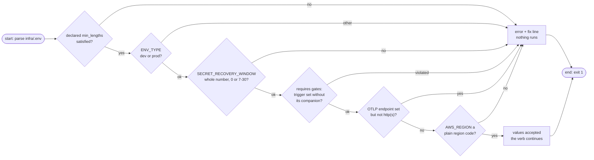
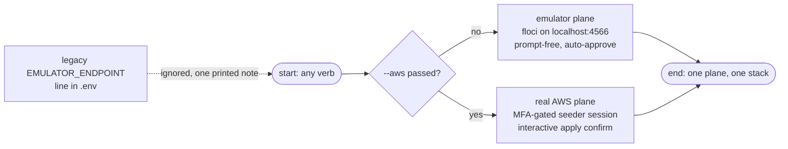

# Values

The values file is a stack's gitignored `.env` beside its declaration — the secrets kind's is the service's `infra/.env` (the observability kind rides `envs/.env`; see [Kinds](kinds.md)). This page is the secrets kind's law. The engine reads it start to finish on every verb: parse, validate against the [declaration](declaration.md), then decide what reaches the plane and what mood to run in. It never writes to it and never prints it.

| File | Role |
|------|------|
| `infra/.env.example` | committed template; safe for the repository |
| `infra/.env` | gitignored (`**/.env` covers it repo-wide); the engine's values source |

A missing `.env` is a first-class error, and the fix comes with the error:

```text
error: services/<name>/infra/.env not found
fix:   create the service's infra/.env first (copy its committed .env.example)
```

## One file, three jobs

Every line lands in exactly one bucket, decided by the declaration:

| Bucket | Which keys | Destination |
|--------|------------|-------------|
| **Secret blob** | the `[secrets] keys` of `secrets.toml` | one JSON version on Secrets Manager at `detectai/<slug>/secrets` |
| **SSM config** | the `[ssm] keys` of `secrets.toml` | plain `String` parameters under `/detectai/<slug>/<KEY>` |
| **Engine controls** | `AWS_REGION`, `ENV_TYPE`, `SECRET_RECOVERY_WINDOW`, `SEEDER_MFA_SERIAL` | never seeded anywhere — they steer the run itself |

Empty or absent lines seed nothing: a commented-out `# NEW_RELIC_LICENSE_KEY=...` line in `.env` seeds nothing for that key. And the allowlist cuts both ways — a `.env` line like `PORT=8000` that no declaration section lists is local-only; it never rides the plane.

This is the full anatomy in practice (from `services/document-parser/infra/.env.example`):

```ini
AWS_REGION=ap-southeast-2            # control: the region the verbs act in
# SECRET_RECOVERY_WINDOW=30          # control: real-AWS only (see below)
# SEEDER_MFA_SERIAL=arn:...          # control: real-AWS MFA pin (see carrier)

API_KEY=change-me-min-16-chars       # [secrets] -> the blob

ENV_TYPE=dev                         # control: the runtime's config posture

UPLOAD_LIMIT_BYTES=3145728           # [ssm] -> plain parameters
MAX_PDF_PAGES=1000
# OTEL_EXPORTER_OTLP_ENDPOINT=http://localhost:4318
```

## The validation ladder

Verbs that *write* to a plane (plan, apply, destroy, auto-apply — and each service in a `session-refresh-all` batch) gate the `.env` through the full ladder before any terraform or IAM call. The comparison-facing verbs (`verify`, `seeder-drop`) skip the ladder and run only its final region check — deliberately, because their job is to comment on the plane, not to re-police your edits.



Every failure prints as an `error:` line with a `fix:` line, and the ladder collects every violation in one pass instead of stopping at the first.

Errors are exactly what they say:

```text
error: API_KEY missing or shorter than 16 chars in the service .env
fix:   set a real value, e.g. API_KEY=<at least 16 chars>

error: NEW_RELIC_LICENSE_KEY missing or shorter than 16 chars while
       OTEL_EXPORTER_OTLP_ENDPOINT is set
fix:   set the required companion key in .env (a throwaway value is legitimate
       when the endpoint is a local receiver)
```

| Rule | Where it comes from | Why |
|------|---------------------|-----|
| `min_lengths` floors | `[secrets.min_lengths]` in `secrets.toml` | mirrors the service's boot-time gates, so the plane holds keys the service will actually accept |
| `ENV_TYPE` ∈ `dev` \| `prod` | checked only if the line exists | tells the engine which runtime shape this `.env` describes |
| `SECRET_RECOVERY_WINDOW` 0 or 7–30 | real AWS only — the emulator ignores the key outright, so only the real plane polices it | 0 means "destroy deletes the secret immediately"; 7–30 is AWS's own recovery-window range |
| `requires` pairings | `[requires]` in `secrets.toml` | a trigger like `OTEL_EXPORTER_OTLP_ENDPOINT` without its license key is a config you only ever discover broken in prod |
| `OTEL_EXPORTER_OTLP_ENDPOINT` http(s) | a URL shape check | a typo'd collector URL should fail loudly before the plane holds it |
| `AWS_REGION` a region code | verb-agnostic — every verb, always | nothing else downstream validates it |

## The plane: decided by the flag, never by the file



Two rules worth burning in:

- **The plane is a property of the invocation, not the file.** `--aws` and its default (`--floci`) are mutually exclusive CLI flags; no `.env` key can flip the destination. A legacy `EMULATOR_ENDPOINT` line from the old service-local drivers is ignored — the run prints one `note:` reminding you of that and moves on.
- **The endpoint is an engine constant.** The emulator always sits at `http://localhost:4566`; `TFCTL_FLOCI_URL` overrides it if you ever need to point at a differently-placed Floci.

## Posture notes the engine volunteers

Validation passes but something looks contradictory? The run says so instead of silently obeying:

| Situation | What prints |
|-----------|-------------|
| `ENV_TYPE=prod` on the emulator | `note:` — the local-testing shape for the prod pull path |
| `ENV_TYPE=dev` on real AWS | `warning:` — a dev runtime reads `.env`, not Secrets Manager; seeding a live plane for a dev runtime is usually not what you meant |
| `SECRET_RECOVERY_WINDOW` set on the emulator | `note:` — ignored, the window is always 0 there |
| `SECRET_RECOVERY_WINDOW=0` on real AWS | `warning:` — destroy will delete the secret immediately, no recovery |

## Hygiene

- Real values go only into gitignored files. The committed `.env.example` stays a placeholder no matter how harmless a value looks.
- The engine prints keys, **lengths, and fingerprints** — never values — everywhere it talks about them.
- An undeclared `.env` key is not an error; it is invisible to the plane. If a key "isn't seeding", check the declaration's allowlists first.

## Next Steps

- **[Carrier](carrier.md)** — the role session these verbs ride and why `SEEDER_MFA_SERIAL` exists
- **[Verification](../guides/verifying.md)** — how the live plane is compared against these values without printing them
- **[CLI reference](../reference/cli.md)** — which verbs run the full ladder and which run only the region check
