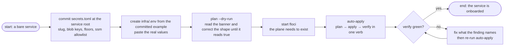

# Onboarding a service

A service joins the secrets plane by contributing **two files**: a committed `secrets.toml` (shape) and a gitignored `infra/.env` (values). Nothing else is copied, forked, or registered anywhere — no make file, no CI job, no IAM to write. The engine reads the pair and drives the plane.

This page walks the first adoption on the emulator, then points at the real-AWS step. The [testing guide](testing.md) is a separate subject — nothing here requires it.

## The path in one picture



## Step 1: declare the shape

Create `services/<name>/secrets.toml`, then validate your structure against the [declaration's schema rules](../concepts/declaration.md). Ask two questions per runtime key:

- **Is it secret?** → `[secrets] keys`. It becomes part of the one JSON blob at `detectai/<name>/secrets`.
- **Is it plain config the service reads?** → `[ssm] keys`. It becomes `/detectai/<name>/<KEY>`.

```toml
[service]
slug = "<name>"              # lowercase-digits-hyphens, ≤ 34 chars: the name drives everything

[secrets]
keys = ["API_KEY"]           # every env name that must stay secret

[secrets.min_lengths]
API_KEY = 16                 # the boot gate, mirrored so the plane refuses what the service would

# [ssm]                      # optional: non-secret config you want on the plane
# keys = ["UPLOAD_LIMIT_BYTES"]
```

Three laws bite early — onboarding is where they all usually trip:

- **The slug is forever.** Every AWS name derives from it; renaming later means a new plane, not a rename.
- **The allowlist is exhaustive.** A `.env` line outside these lists never reaches the plane; plan's `--dry-run` banner tells you what *will* ride if you are unsure.
- **The planes are disjoint.** The same key in `[secrets]` and `[ssm]` is a refused declaration, not a warning.

## Step 2: provide the values

Copy the service's committed template into the gitignored real one and fill it in (a repository `**/.env` gitignore rule keeps the real file out of git wherever it sits):

```sh
cd services/<name>
cp infra/.env.example infra/.env    # then edit: real values, no placeholders
```

The engine's [validation ladder](../concepts/values.md) checks the blob keys against your `min_lengths` floors and a handful of consistency rules — expect the first `plan` to tell you each rule by name.

## Step 3: read the dry run

```sh
poetry -C tools/tfctl run tfctl --service <name> plan --dry-run
```

(From inside a service directory you can drop `--service` — the engine finds the nearest `secrets.toml` walking upward. The flag form works from anywhere because the repo root is anchored off the tool's location.)

The banner previews everything the real run would do: plane, keys with lengths, the exact bucket and state key, and the composed backend. Skipping real execution until this page reads true is the cheapest mistake insurance in the whole flow.

## Step 4: build the plane

```sh
docker start floci                                                   # or your Floci container's name
poetry -C tools/tfctl run tfctl --service <name> auto-apply
```

`auto-apply` is onboarding's one-button verb: it validates, runs terraform plan then apply (auto-approved on the emulator), then immediately verifies the live plane against your `.env`. A first run shows two self-heals on the way in — the seeder role being [created and converged](../concepts/carrier.md#one-verbs-ride-through-the-carrier), the state bucket [healed into existence](../guides/terraform-lifecycle.md#the-state-bucket-heals-itself) — both normal on a brand-new plane.

An explicit `verify` re-runs just the proof any time:

```sh
poetry -C tools/tfctl run tfctl --service <name> verify
```

## Step 5: real AWS later, not first

Everything above is identical on real AWS except the gate flag — `--aws` — and its two consequences: an [MFA prompt](../concepts/carrier.md#who-the-role-trusts) per 12-hour carrier window, and an interactive confirmation on `apply`. Leave production-shaped runs until the emulator flow is boring, and make your first real verb `plan`.

## What "onboarded" means afterwards

| You can now | With |
|-------------|------|
| Seed a values change to the plane | edit `.env` → `plan` → `apply` → `verify` |
| Wipe the plane and start over | `destroy` (or `destroy --purge-state --drop-seeder` for the full teardown) |
| Clear a stale 12-hour session | `session-clear` |
| Refresh every service's sessions in one run | `session-refresh-all` |

## Next Steps

- **[The terraform lifecycle](terraform-lifecycle.md)** — what `auto-apply` and `destroy` do under the hood
- **[Verification](verifying.md)** — the meaning of every row your green run printed
- **[Testing](testing.md)** — the two tiers that keep an onboarded service honest
