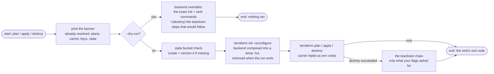
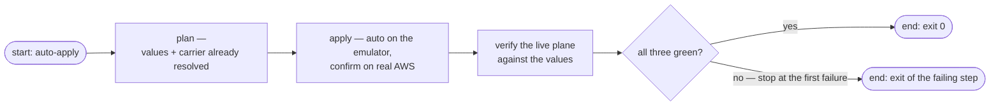

# Lifecycle

The plan / apply / destroy / auto-apply verbs over the service's secrets plane — the engine's terraform half. Here is what a run actually does: how the stack is addressed, how terraform is fed, how the state bucket heals itself, and how teardown removes everything without a single confirmation prompt.

Read the [carrier page](../concepts/carrier.md) for the role session underneath every run, and [values](../concepts/values.md) for the validation ladder gating entry to this page.

## The stack: one for every service

One terraform root serves the whole repo — `tools/tfctl/app/kinds/secrets/stack/` — with a single generic module, `modules/secrets-plane`. Per service, nothing is generated anywhere; the run composes its identity purely from inputs:

| Input | Source | Becomes |
|-------|--------|---------|
| `TF_VAR_service_slug` | secrets.toml | every derived name ([declaration](../concepts/declaration.md)) |
| `TF_VAR_blob` | the `.env` lines your `[secrets] keys` allowlisted | the Secrets Manager version (sensitive, JSON) |
| `TF_VAR_ssm_parameters` | the `.env` lines your `[ssm] keys` allowlisted | `String` parameters under the service prefix |
| `TF_VAR_secret_recovery_window` | 0 on the emulator; declaration default 30 or your `.env` override on real AWS | the secret's recovery window |
| `TF_VAR_aws_region` | `.env`'s `AWS_REGION` or the declaration default | provider region |
| `TF_VAR_emulator_endpoint` | the engine constant (`localhost:4566`) — floci runs only | flips the provider to the emulator plane |

The resources terraform manages are deliberately boring:

| Resource | Name | Notes |
|----------|------|-------|
| Secrets Manager blob | `detectai/<slug>/secrets` | created with the chosen recovery window |
| Secrets Manager version | inside the blob | one JSON object `{KEY: value, …}` — seeded only when at least one blob key has a value |
| SSM parameters | `/detectai/<slug>/<KEY>` | `String` type, per non-empty allowlisted key |

No IAM, no S3 state-bucket-in-stack (the bucket is engine tooling, [healed on demand](#the-state-bucket-heals-itself)), no account-ID literals — the stack is addressed entirely by service-pinned names. The provider block adapts itself per plane: the emulator gets `test` credentials, the `skip_*` flags, path-style S3, and endpoint overrides for `secretsmanager`, `ssm`, `iam`, `sts`; real AWS gets none of that.

## The verb anatomy

Every run opens with the banner — the run's whole world in eight lines:

```text
plane:   floci (emulator http://localhost:4566)
carrier: role session (detectai-document-parser-seeder, valid 11:59:41)
stack:   tools/tfctl/app/kinds/secrets/stack
secret:  detectai/document-parser/secrets
keys:    API_KEY *** (18 chars, hidden) NEW_RELIC_LICENSE_KEY *** (21 chars, hidden)
state:   detectai-document-parser-tfstate-000000000000 / document-parser/floci/terraform.tfstate
window:  0 day(s)
config:  15 key(s) -> SSM /detectai/document-parser/
```

Then the machinery, in fixed order:



Rules pinned inside that flow:

- **Backend is always composed, never bare.** The engine writes a temp `.hcl` (bucket, key, region, per-plane flags) and feeds `init -reconfigure`. A naked `terraform init` in the stack directory is not valid — the partial `backend "s3" {}` in `versions.tf` guarantees it. Real AWS adds `encrypt = true` and a lockfile (`use_lockfile`, hence the Terraform ~> 1.10 pin); the emulator adds path-style and the S3 endpoint override.
- **Approvals are per plane, per verb.** Apply auto-approves on the emulator and keeps its interactive confirm on real AWS. Teardown never waits on input: destroy auto-approves on **both** planes. Plan never prompts.
- **The temp backend file is unlinked on the way out** — success or failure.

## The state bucket heals itself

The bucket is not a terraform resource, because terraform cannot stand on a ledger that does not exist. Before every acting run the engine heads the derived bucket (`detectai-<slug>-tfstate-<account>`) and creates it — versioning enabled — when missing:

- The emulator restarts forget, so the first plan after `docker start floci` prints `note: state bucket … is missing; creating it` and proceeds. That note is normal, not an error.
- A failed init still tells you where to look: on the emulator the fix is "is Floci reachable?"; on real AWS it is backend access to the named bucket in the named region.

## auto-apply: the whole seed in one verb



`--dry-run` turns it into a printed three-step script instead of running any of it.

## Teardown

`destroy` is the only verb with a tail, and the tail is exactly what you flag:

```mermaid
graph LR
    START(["start: terraform destroy succeeded"]) --> WINDOWP["the secret enters its recovery window<br/>(0 on the emulator = gone immediately)"]
    WINDOWP --> FD{"--force-delete?<br/>real AWS only"}
    FD -->|"yes"| FDRUN["secretsmanager delete-secret<br/>--force-delete-without-recovery"] --> PURGE
    FD -->|"no / emulator"| PURGE{"--purge-state?"}
    PURGE -->|"yes"| PPREV["preview: count versions,<br/>warn when the bucket holds<br/>objects outside the slug prefix"]
    PPREV --> PRUN["delete every object version,<br/>then the bucket itself<br/>(rerunnable)"]
    PRUN --> DROP{"--drop-seeder?"}
    PURGE -->|"no"| DROP
    DROP -->|"yes"| DROPRUN["detach seeder-policy,<br/>delete the role<br/>(ambient personal creds)"]
    DROP -->|"no"| END(["end: everything you aimed at is gone"])
    DROPRUN --> END
```



- **Purge is guarded by two safeties**: it runs only after terraform destroy actually succeeded, and its preview warns loudly when the bucket holds objects outside your slug's prefix — deleting a shared bucket takes sibling stacks' ledgers with it.
- **`--force-delete` skips an existing recovery window** on real AWS; on the emulator it is a no-op note (the window is always 0 there).
- **Completeness by flags, never by guessing**: with no flags, the state bucket, its ledger, and the seeder role survive; `make`-style full teardown is `destroy --purge-state --drop-seeder`.

## Good to know

- **The two planes never share a ledger.** Their state keys differ (`<slug>/floci/…` vs `<slug>/…`), and the bucket name carries the plane's account.
- **Re-pointing repoints, nothing migrates.** The ledger address is derived (bucket from slug + account, region composed into the backend file); change any input that feeds it and terraform stands in front of a different, empty state — `plan` will honestly offer to recreate the world.
- **Init reuse is free.** After a plain `destroy` (bucket kept), the next apply re-initializes against the kept ledger, which now holds empty state — no re-setup.
- **Real AWS plan/apply runs are interactive-safe**, while destroy and everything on the emulator run unattended — `stdin` closed is a valid way to script them.
- **Version pin**: the stack requires Terraform ~> 1.10 (the `use_lockfile` backend addition on real AWS) and AWS provider ~> 5.0.

## Next Steps

- **[Verification](verifying.md)** — the post-apply proof the plane matches your `.env`
- **[Carrier](../concepts/carrier.md)** — the MFA gate and cache behind the `carrier:` banner line
- **[CLI reference](../reference/cli.md)** — the exact flag matrix for these verbs
